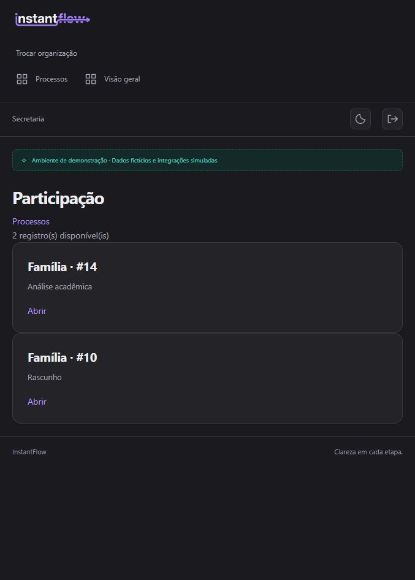

# Current family-isolated demo — 2026-10-24

Port [4002](http://127.0.0.1:4002) now serves a fresh isolated instantflow_demo
on PostgreSQL 127.0.0.1:55434, with private local data under
.local/d04-family-demo. The prior accepted database under .local/d04-clean-rehearsal
(port 55433) is preserved, including its independent builder process. Its web
server was stopped. The older web server on 4001 was also stopped as requested;
its PostgreSQL cluster remains available for the test database.

The authorization model is unchanged: a family requires a verified relationship
on each individual case. The old synthetic fixture explicitly linked one account
to all 12 cases. New fixtures give six external accounts separate sibling groups.

| Account | Students | Case IDs in this fresh installation |
|---|---|---|
| familia@escola.example | 01, 05 | 9, 13 |
| familia.santos@escola.example | 02, 06 | 10, 14 |
| familia.costa@escola.example | 03, 07 | 11, 15 |
| familia.lima@escola.example | 04, 08 | 12, 16 |
| familia.rocha@escola.example | 09, 10 | 17, 18 |
| familia.alves@escola.example | 11, 12 | 19, 20 |

Passwords are provided separately in the conversation and preserved on rerun.
There are 13 demo accounts: seven internal accounts and these six families.

## Walkthrough and evidence

Sign in as familia@escola.example, then Abrir processos → Abrir participação
under Matrícula de estudantes · Família. Only #9 (Rascunho) and #13 (Correção)
appear. #13 can demonstrate correcting school year and resubmitting.
Sign out, then sign in as familia.santos@escola.example: only #10 and #14 appear.
A direct attempt by Santos to open Oliveira's #9 redirects to Processos.
These two lists and the foreign-record denial were checked in the browser.

The [fresh inventory](evidence/demo-readiness/family-isolation-inventory.json)
contains 29 cases in four school workflows. The initial setup and a repeated
setup returned identical inventories. The six-group test checks each family's
listing, own reads, foreign read denial, foreign save denial and repeat stability.
The previous D04 screenshots remain historical evidence from the preserved database;
this check does not claim a second complete D04 rehearsal.

The setup refuses old enrollment fixture receipts lacking their expected new
family link. It does not silently reassign presenter-edited participant access.
Use a fresh isolated cluster for the new distribution. Existing revoked links
are not reactivated by a rerun.
