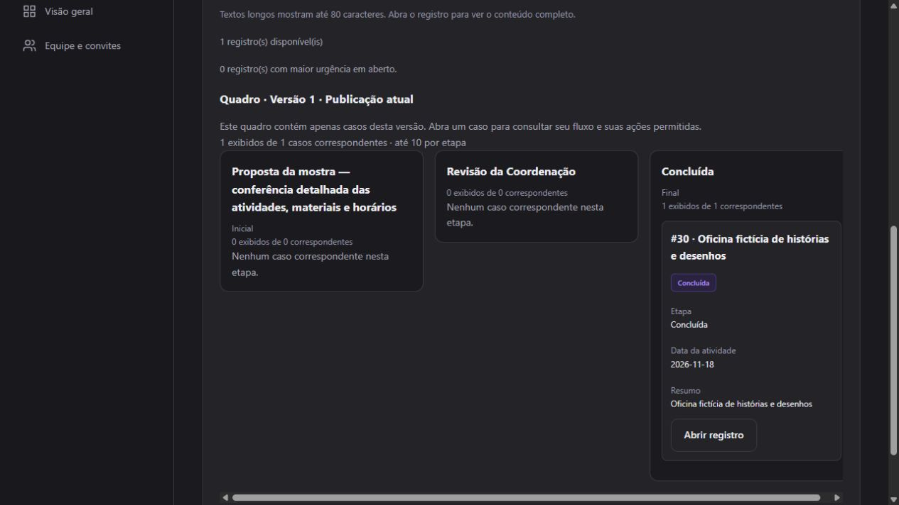

# D04 final clean acceptance — 2026-10-24

Current serving dataset: see [family isolation](demo-family-isolation.md). This report
records the earlier accepted dataset on cluster 55433, including its shared fictional
family and independently authored fifth process. It is preserved with its server
stopped; port 4002 now serves a fresh four-process dataset on cluster 55434.

**Passed for the isolated local synthetic demonstration.** A fresh 29-case school,
the full presenter walkthrough and an independently authored process were exercised
through the browser on the final fixed application code. No application edits,
direct case/database mutations, permission bypasses or unexplained reloads were
needed during the accepted pass. Deliberate validation failures were corrected
through the UI. Application commit: **a7a5e93**.

At acceptance, the demo was running at [127.0.0.1:4002](http://127.0.0.1:4002) with its board
and case flow open. The original [localhost:4001](http://localhost:4001) demo and its
database were preserved. Login credentials are supplied in the private conversation;
no passwords are committed here. This acceptance does not enable real integrations,
production hosting or deferred customer-delivery sprints.

## Clean setup and preservation

The acceptance used a separate PostgreSQL 16 cluster under ignored
.local/d04-clean-rehearsal/pgdata, bound only to 127.0.0.1:55433. PostgreSQL's Unix
socket is also inside that private rehearsal directory. The original cluster at
55432 was not reset. Both repository connections targeted the explicitly named
instantflow_demo in the new cluster, using independently generated local credentials.
The existing bundled PostgreSQL/runtime described in the README was reused.

The empty cluster was initialized with initdb, a private operator password file,
scram-sha-256 host authentication and a private local socket. pg_ctl started it on
55433. The application preparation then followed the supported task sequence:

~~~sh
export MIX_ENV=dev
export PGHOST=localhost
export PGPORT=55433
export INSTANTFLOW_DEMO_DATABASE=instantflow_demo
unset OPERATOR_DATABASE_URL MIGRATION_DATABASE
# Supply MIGRATION_PGPASSWORD matching the new cluster's operator password,
# plus RUNTIME_DB_PASSWORD and DEMO_PASSWORD privately; do not echo them.
mix ecto.create -r Instantflow.OperatorRepo
mix ecto.migrate -r Instantflow.OperatorRepo
mix instantflow.db_roles
mix instantflow.demo.setup --database instantflow_demo
mix instantflow.demo.setup --database instantflow_demo
PORT=4002 mix phx.server
~~~

No cluster-wide role password in the original cluster was changed. Fresh and repeat
setup returned identical inventories: 12 enrollments, eight purchases, six trips,
three incidents; one primary publication per process, all v1. Earlier rehearsal
attempts exposed two builder defects; after each fix, only this disposable cluster's
named demo database was reset with the guarded setup task. The accepted pass began
again from the same 29-case inventory, after the final fix. The initial and final
[inventories](evidence/demo-readiness/d04-clean-initial-inventory.json) are retained;
[a post-walkthrough setup rerun](evidence/demo-readiness/d04-clean-after-inventory.json)
also succeeded without undoing user actions or duplicating cases.

Read-only fingerprints of the original cluster's tickets and workflow drafts were
identical before/after: **42 tickets and 2 drafts**, including their row hashes.
See [preservation evidence](evidence/demo-readiness/d04-clean-existing-preserved.json).
The final clean cluster has **30 cases** after adding one independent case; all
remain pinned to v1. Its [complete stage inventory](evidence/demo-readiness/d04-clean-final-cases.json)
includes the independent process as well as the four school examples.

The browser used 127.0.0.1 rather than localhost so the clean environment's login
cookies did not replace the original demo session. Both services remain available.

## Accepted presenter walkthrough

The exact PT-BR route is in [the presenter script](demo-readiness-rehearsal.md).
The accepted clean pass used its purchasing, enrollment, trips, optional confidential
example and independent builder sections, with these concrete outcomes:

| Step | Observed result |
|---|---|
| Presenter login and overview | Fictional Horizonte and its four populated school processes loaded normally |
| Purchasing board and transition | Tintas #3 moved finance → purchase; another connected tab showed it in Compra without reload |
| Returned purchase | Tecidos #7 retained its return history; a new justification note saved and survived explicit reload |
| Restricted teacher | Exactly one purchase visible; #1 could be submitted but had no approval action; opening #3 was denied with useful feedback |
| Family portal | Exactly 12 enrollments visible through Abrir processos → Abrir participação; #13 school year corrected and resubmitted to documents |
| IT view and recovery | Only minimum identity shown; #18 finish rejected until simulated provisioning succeeded on retry 2; completion reached revision 14 without a stale error |
| Trips | Director saved safety confirmation for #25 and approved it; revision 9, complete |
| Confidential incidents | Director saw three cases without counselor notes; counselor saw two assigned cases with notes and without discipline; presenter saw zero incident cases |
| Independent builder | Starter, date field, long initial-stage label, review stage, ordering, submit/approve actions, explicit local mappings and board configured entirely through typed UI controls |
| Invalid authoring and recovery | Empty board columns rejected; corrected columns saved normally; old error cleared; publication cancel left a draft, confirmation published v1 |
| Separate requester/reviewer | Teacher created #30, saved summary/date and submitted; no approval action; presenter approved it to revision 4, closed |
| Generated board/flow | The connected board moved #30 from review to closed; the case flow identified pinned v1 and current closed stage |
| Reload/login stability | Repeated account switching and explicit reloads retained authorized access and persisted values; no invalid-session failure observed in the accepted pass |

## Layout, keyboard and state checks

Actual browser viewport: **1280 × 720**, with a 1265-pixel document width due to its
vertical scrollbar. No viewport, zoom or stylesheet overrides were used. The board's
horizontal overflow remains inside its focusable scroll region. Arrow keys moved
that region; the flow's focus selector, Tab navigation and scrollable diagram were
also exercised. Selected stages and the readable connection list stayed available.

The independent initial-stage label was deliberately long:
Proposta da mostra — conferência detalhada das atividades, materiais e horários.
Its board heading wrapped fully: client/scroll width both 256 px; client/scroll
height both 77 px. It did not overflow the document. The graph abbreviates long
node text, while its selector and accessible stage/connection list retain the full
label. This expected accessible alternative was verified in the pinned flow.

An unmatched purchasing search showed zero matching cases with explicit empty
columns. Expected denied-access and unmet-delivery guards showed errors and did
not mutate the case. The builder's deliberate empty-column error still uses a
schema-path message; correction and clearing of that message were verified. That
copy is technical, but it did not block the presenter or require a repair outside
the UI.

Browser automation waits for the LiveView connected state after a full navigation,
then for visible save/action outcomes. Earlier over-fast actions during static
render and before save acknowledgement were not counted as successful actions.
The accepted pass used those readiness checks; it required no changes to application
code after starting that pass. An earlier browser timeout was inspected rather
than treated as success or blindly retried.

## Defects found and fixed before the accepted pass

Two builder recovery defects were fixed in a7a5e93:

1. A failed new-item save marked the new key as an existing item before persistence
   succeeded. Correcting the invalid item then failed as not found. Selection now
   becomes an existing item only after a successful save.
2. A successful corrected save or publication could retain an obsolete error flash.
   Those success paths now clear the old error.

Regression tests cover invalid board → correction → publication, editable key
retention after failure, normal readonly behavior after success, and stale error
clearing on save/publication. Initial unsuccessful attempts are distinct from the
final accepted pass; [one initial validation screenshot](evidence/demo-readiness/d04-initial-attempt-builder-validation.png)
is retained as diagnostic evidence rather than represented as final proof.

## Validation and evidence

- Focused fixtures, builder and stage-board suites: **30 tests, 0 failures**,
  seed 865528; 21.8 seconds; 97 token-age checks, zero invalid results.
- Final instrumented mix precommit: **378 tests, 0 failures**, seed 865528;
  166.9 seconds; 1198 token-age checks, zero invalid results, largest future delta 0 ms.
- A concurrent 60-second clock sample: 29,975 samples; zero backward reads;
  zero discrepancies above 50 ms; largest wall/monotonic discrepancy **33 μs**.
- Existing migration module-redefinition warnings were unchanged. No test VMs
  overlapped against the same test database. Git diff --check passed.

The [compact validation record](evidence/demo-readiness/d04-clean-validation.txt)
retains command/result details. The earlier clock failures remain historical
evidence; the [configuration remediation](demo-clock-remediation.md), clean samples
and this successful browser run together support this acceptance. Suspend/resume
and OS restart were not forced and are not claimed as tested.

Additional final-pass screenshots:

- [Long-label empty board](evidence/demo-readiness/d04-clean-long-label-empty-board.png)
- [Completed pinned flow](evidence/demo-readiness/d04-clean-builder-completed-flow.png)
- [Requester submitted, approval absent](evidence/demo-readiness/d04-clean-builder-requester.png)
- [Corrected builder state](evidence/demo-readiness/d04-clean-builder-corrected.png)
- [Empty search](evidence/demo-readiness/d04-clean-empty-search.png)
- [Restricted access denial](evidence/demo-readiness/d04-clean-teacher-denied.png)
- [Family resubmission](evidence/demo-readiness/d04-clean-family-resubmitted.png)
- [IT guard](evidence/demo-readiness/d04-clean-it-guard.png) and [completion](evidence/demo-readiness/d04-clean-it-completed.png)
- [Director fields](evidence/demo-readiness/d04-clean-director-fields.png) and [counselor fields](evidence/demo-readiness/d04-clean-counselor-fields.png)
- [Approved trip](evidence/demo-readiness/d04-clean-trip-approved.png)
