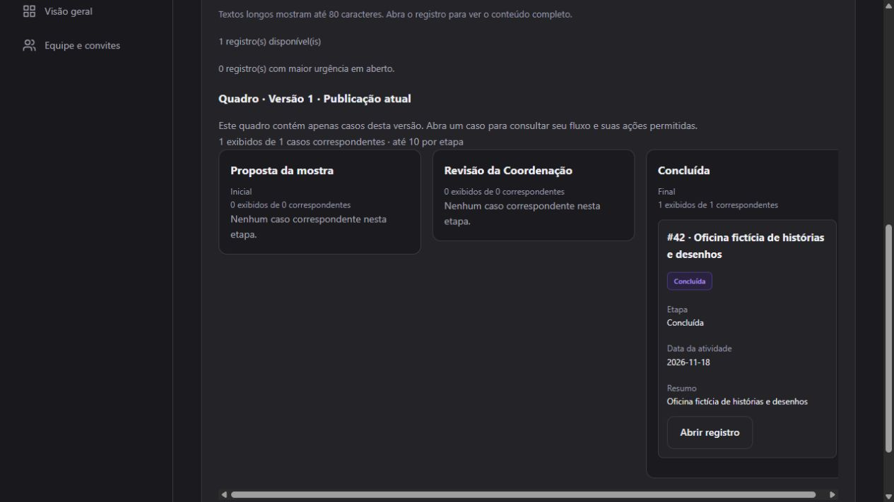

# D04 rehearsal — 2026-10-24

The independent builder proof and the four school examples were exercised in the
isolated local demo. D04 is **not complete**: the local OS clock still moves
backward and can invalidate a freshly signed LiveView session. Do not present a
passing rerun as a repair. Setup and role details remain in [school-demo.md](school-demo.md).

## Changes prompted by the rehearsal

The builder can now move stages up/down before publication. The saved order feeds
the published definition, board and graph. Boundary/invalid moves do not save;
unsaved form edits are protected; stale editors retain the existing conflict path;
published versions remain immutable. Controls have stage-specific accessible names.

Publication now has an explicit in-app review/confirm/cancel step instead of a
native browser confirmation. The original browser click timed out before publication
was observed, and the user subsequently reported exhausted usage. The saved draft
was reopened after usage returned. No claim is made that the timeout proved a
browser defect. Publication still uses the existing authorization, validation and
optimistic revision checks. Canceling leaves the draft unpublished.

Successful form saves, transitions and simulated delivery retries clear obsolete
command-error feedback. The IT rehearsal exposed the old guard error remaining
visible after a successful retry and completion. The corrected UI was rechecked
on a second failed provisioning case, and regression coverage follows that recovery
through the same LiveView.

## Roteiro PT-BR: processo independente

Use a instalação isolada descrita no guia. Entre como admin@escola.example.
Para repetir em um banco já ensaiado, use outra chave ainda não publicada; não
substitua o processo existente ou seus casos.

1. Abra **Modelos de fluxo**. Escolha **Formulário e aprovações**, chave
   mostra_cultural_demo e nome **Organização da mostra cultural**. Crie o rascunho.
2. Em Mapeamentos, associe Solicitante a **Professor**, Responsável a **Coordenação**
   e Departamento responsável a **Coordenação**. Salve. Isso utiliza concessões
   existentes; não concede novos papéis às pessoas.
3. Em Editar itens, prepare um **Campo** na seção Solicitação: chave activity_date,
   rótulo **Data da atividade**, tipo **Data**. Salve.
4. Edite a etapa inicial para **Proposta da mostra**. Adicione etapa review,
   **Revisão da Coordenação**, sem marcar inicial/final. Use **Subir** para colocá-la
   entre a proposta e Concluída. Salve edições pendentes antes de reorganizar.
5. Edite a transição complete: rótulo **Aprovar mostra**, origem Revisão da
   Coordenação, destino Concluída, papel no departamento atribuído **Responsável**.
   Exija resumo/data e mantenha a proibição de aprovação pelo próprio solicitante.
6. Prepare outra **Transição**, chave submit, **Enviar proposta para revisão**:
   proposta → revisão, papel do próprio solicitante **Solicitante**, resumo/data
   obrigatórios. O envio pelo solicitante é intencional; a aprovação continua separada.
7. Prepare uma **Visualização** board, **Preparação por etapa**, tipo **Quadro por
   etapa**, colunas etapa, data e resumo. Revise os papéis, departamentos, etapas e
   caminhos. Clique **Publicar versão revisada** e **Confirmar publicação**.
8. Saia e entre como docente@escola.example. Abra o novo processo e **Iniciar registro**.
   Use resumo **Oficina fictícia de histórias e desenhos**, data **18/11/2026**.
   Salve, aguarde a confirmação e envie para revisão. O solicitante não recebe a
   ação Aprovar mostra. Abra o fluxo desta versão para explicar o caminho.
9. Volte como admin. Selecione Preparação por etapa e Filtrar. Abra o cartão em outra
   aba, aprove a mostra e observe o quadro conectado: o caso passa para Concluída.
   Consulte o fluxo fixado no caso e a lista acessível de etapas/conexões.

This proof used only the typed builder controls for configuration: no JSON editing,
fixture injection or direct database edits. The resulting process is local workflow
#5, published v1; case #42 was created by the teacher, submitted at revision 3 and
approved by the presenter at revision 4. Its board has proposal/review/completed in
that order and an authorized summary/date. Another connected tab received the
completion update. Reloading retained session/access and loaded the normal default
table; selecting the board again showed the completed case. Flow stage selection
and keyboard Tab navigation were exercised. The longer label/scrolling checks from
[D02](demo-flow-visual-rehearsal.md) and [D03](stage-boards.md) remain separate evidence.

## Roteiro PT-BR: quatro exemplos da escola

1. Como admin, abra compras. Confira o histórico de devolução de **Tecidos**, edite a
   justificativa, salve e aguarde **Formulário salvo**. Consulte seu fluxo e o quadro.
   Compare com docente: apenas a compra própria aparece; a demonstração independente
   também permite criar propostas, mas não aprová-las.
2. Como familia@escola.example, use **Abrir processos → Abrir participação** na página
   **Matrícula de estudantes · Família**. A entrada é de participação, não o menu
   interno da equipe. Abra uma matrícula em Correção, ajuste Ano/série, salve no
   botão desse campo e reenvie. A página não mostra avaliação acadêmica, pagamento
   ou identidade interna de TI. Não há envio real.
3. Como ti@escola.example, abra uma matrícula com provisionamento falho. Só a
   identidade mínima aparece. Tentar concluir antes do sucesso deve mostrar o
   bloqueio. Use **Tentar novamente**, aguarde duas tentativas com sucesso e conclua.
   O erro anterior deve desaparecer. Se não houver mais casos falhos no banco já
   ensaiado, use os casos históricos ou prepare novamente a demo descartável pelo
   procedimento explícito do guia; rerun não desfaz ações já realizadas.
4. Como direcao@escola.example, abra um passeio em Análise de segurança. Confira
   data, roteiro, riscos e transporte fictícios. Marque as medidas como Sim, salve
   e aguarde a confirmação antes de aprovar. A aprovação usa o orçamento sintético.
5. A parte confidencial é opcional. A direção vê três ocorrências e pode consultar
   triagem/comunicação. Não vê as notas privadas. Como orientacao@escola.example,
   aparecem apenas os dois casos atribuídos; abra Acompanhamento e confira suas
   notas, sem disciplina/comunicação. Como admin, a lista de casos de incidentes
   deve continuar vazia. Não copie notas privadas para mensagens curadas.

Browser observations and mutations in this run:

| Example | Result |
|---|---|
| Purchasing #7 | Existing return history and prior note retained; justification appended with a D04 rehearsal note; revision 6, still draft |
| Enrollment #34 | Family changed school year to a fictional correction and resubmitted; now documents |
| Enrollment #39 | IT completion initially rejected; simulated retry succeeded on attempt 2; completed at revision 14 |
| Enrollment #40 | Repeated guard/retry/completion after stale-feedback fix; no obsolete error after success; completed at revision 14 |
| Trip #25 | Director saved safety confirmation then approved; revision 9, complete |
| Incident #28 | Director and assigned counselor projections inspected; no incident mutation |
| Independent #42 | Teacher created/submitted; separate reviewer approved; connected board refreshed |

The first immediate trip save did not yield a confirmed save before approval was
attempted; approval stayed disabled while the local draft was dirty. The settled
form was saved and confirmed before advancing. The script therefore explicitly
waits for save feedback. This run does not establish a root cause for that timing
observation or claim it never recurs.

All login switches used the existing local synthetic password without printing or
committing it. Historical enrollment v1 remains intact. The local demo now contains
42 cases, including 12 historical enrollments and the independent case. Initial
fixture counts in the D01 inventory intentionally describe pre-rehearsal state.

## Evidence and validation

- [Teacher submission and unavailable approval](evidence/demo-readiness/d04-builder-requester-submitted.png)
- [Pinned independent flow](evidence/demo-readiness/d04-builder-pinned-flow.png)
- [Family resubmission](evidence/demo-readiness/d04-family-resubmitted.png)
- [Minimal IT identity and clean completion feedback](evidence/demo-readiness/d04-it-completed.png)
- [Director fields](evidence/demo-readiness/d04-director-fields.png)
- [Counselor fields](evidence/demo-readiness/d04-counselor-fields.png)
- [Approved trip](evidence/demo-readiness/d04-trip-approved.png)
- [Saved purchase correction](evidence/demo-readiness/d04-purchase-correction.png)

The affected builder/view suite passed 11 tests (seed 590195). The guarded retry
and field-surface suite passed 22 tests (seed 865528; 585 token-age checks, zero
invalid results). The final builder suite passed 10 tests (seed 541978), including
unsaved-edit protection and invalid moves. Final instrumented mix precommit passed
377 tests with zero failures (seed 865528; 162.9 seconds), with 1194 token-age checks,
zero invalid results and largest future delta 0 ms. The earlier full-run failure
and independent backward-clock observation remain release blockers despite that pass.
The UI asset build and git diff --check passed. Existing migration-redefinition
warnings remain unchanged. Compact evidence is in
[d04-validation.txt](evidence/demo-readiness/d04-validation.txt).

## Open clock gate

A full instrumented precommit run failed one of 376 tests in
Sprint11FieldSurfaceMatrixTest: token age validation rejected a timestamp **403 ms
in the future**. The same failure shape had already been diagnosed in D03.
A subsequent 30-second read-only preflight recorded 15,001 samples, one backward
OS-time read, and a maximum wall/monotonic interval discrepancy of **409,039 μs**.
This is direct evidence outside session validation; it does not identify the
ultimate cause. WSL reports kernel 6.18.54.1-microsoft-standard-WSL2, current
clocksource tsc, and NTP synchronized. Kernel logs show the switch to tsc at
boot; this alone does not prove that clocksource caused the regression.

Run the bounded check before a presentation:

~~~sh
elixir scripts/check_demo_clock.exs 30
~~~

It exits 1 if any backward OS-time read or interval discrepancy above 50 ms is
observed. It does not modify clocks, kernel settings, token validation or credentials.
A passing sample only describes that interval. OS/host clock stability must be
resolved and independently rechecked before declaring the demo ready. No token
backdating, validation weakening, dependency patches or OS clock changes were used.
